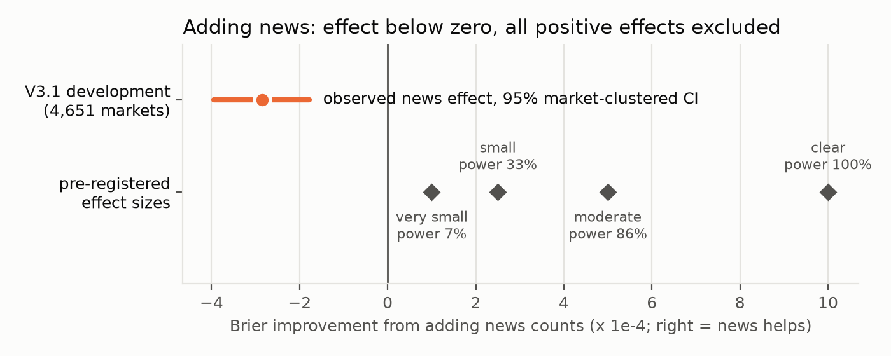
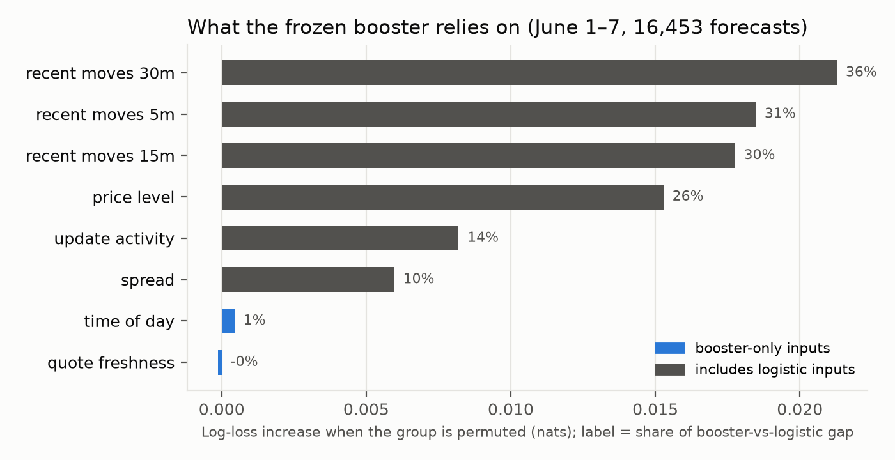
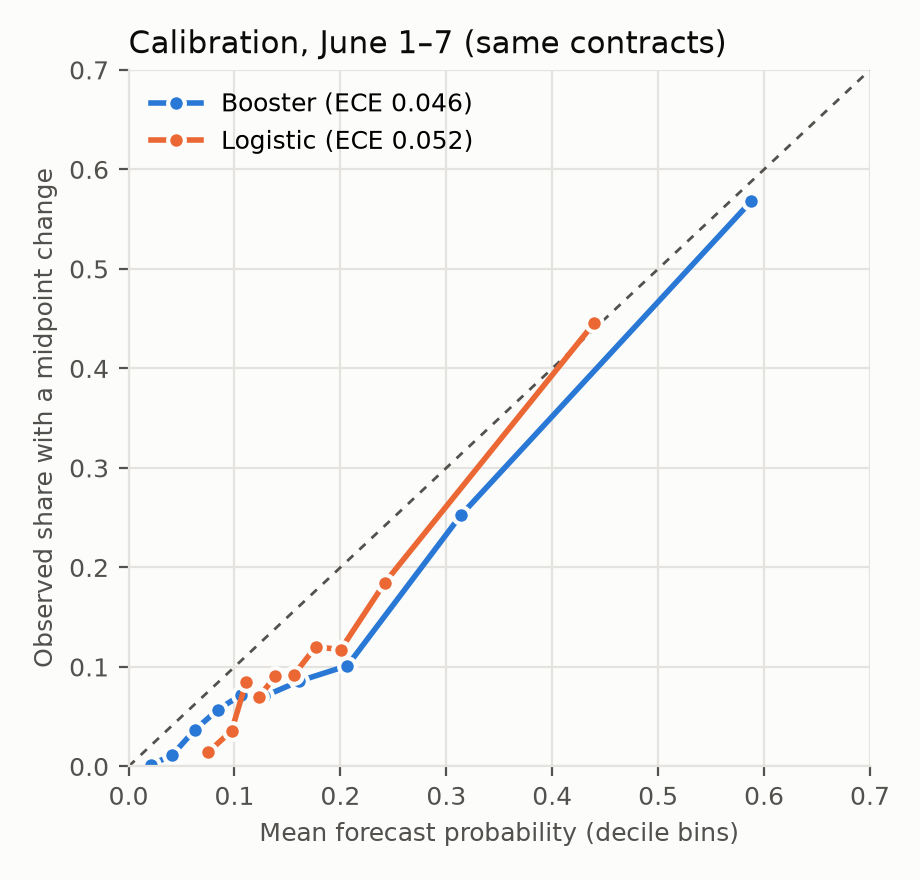

# EventX: final report (DRAFT — live and V4 sections pending Friday 30 Oct)

**Student:** Zhu Rong · **Supervisor:** Lu Yao · **Due:** 1 November 2026
**Status of this draft:** written 27 Oct 2026. The placeholders marked `[PENDING]` (V4, June 15–28 and live V02b) are filled from once-only evaluations that open on 30 Oct. Every other number is from a completed, frozen evaluation.

## 1. Summary

EventX asks whether external information (news, later KOL posts) contains incremental, point-in-time predictive information about prediction-market repricing. The project has two answers so far.

1. **News on top of market history: negative.** In the frozen V3.1 historical study (4,651 markets), adding counts of conservatively available, lexically associated news articles to a market-history logistic model made both average precision and Brier score worse (AP change −0.001916; Brier improvement, B0 minus B1, −0.000284). The paired block-bootstrap Brier interval was [−0.000341, −0.000230], and all five promotion gates failed. A post hoc market-cluster bootstrap (2,290 contributing markets) puts the one-sided 95% upper bound of the Brier improvement from news at −0.000196, below zero and below every positive effect size registered before labels were seen, including the smallest, "very small" one (+0.0001 Brier) (§2.1). Later opened-data diagnostics (V5/V6) traced apparent news gains to context or nonlinearity controls. The richer-news V4 confirmation (470 Polymarket contracts, 6 Sep–30 Oct) is sealed and still collecting. **[PENDING: V4 B3-vs-B0 result]**
2. **A forecastable microstructure target: positive, replicated out of time and on new contracts.** The project defined a narrower target: the probability that a contract's YES midpoint 30 minutes later differs from its current value. In every completed frozen-model evaluation below, the frozen booster had lower matched log loss than its specified comparator: the 18-feature row_hgb7 against activity logistic regression, and the 14-feature V03 live model against its own full logistic. May 9 is development, not a frozen-model test; pending rows are not yet evaluated. A post hoc online contract rate built from each contract's matured outcomes came close to the booster on the new contracts (LL 0.4231 vs 0.4208; §3.2), so the advantage is over the specified fixed baselines, not every simple reference. Quote features appeared most useful when little contract-specific outcome history was available; their value after history accumulates remains uncertain on unseen contracts.

| Block | Opened before? | Contracts | Booster LL | Logistic LL | LL reduction | 95% contract-clustered CI of gain, logistic minus booster (nats) |
|---|---|---:|---:|---:|---:|---|
| May 9 (development) | yes, repeated use | — | — | — | 16.0% (V03) | — |
| May 13–19 replication | first use | 30 | 0.3583 | 0.4524 | 20.8% | — |
| **June 1–7, unopened** (development cohort) | no | 18 | 0.2931 | 0.3523 | **16.8%** | [0.039, 0.080] (secondary) |
| **June 8–14, unseen contracts** | no | 35 | 0.4208 | 0.4943 | **14.9%** | [0.033, 0.119] (pass rule) |
| June 8–14, V03 live model (vs its own full logistic) | no | 35 | 0.4270 | 0.5316 | **19.7%** | [0.066, 0.147] |
| **June 15–28, unseen contracts** | no | 21 selected | [PENDING] | [PENDING] | [PENDING] | [PENDING] |
| **Live V02b, 27 Oct 06:35–29 Oct** | prospective | 30 | [PENDING] | [PENDING] | [PENDING] | [PENDING] |

The target is quote *activity* only. It says nothing about direction, size, resolution or profit, and it is not a test of news.

**Why forecast quote activity (motivation, not demonstrated benefit).** The target resolves every 30 minutes, so a frozen model can be tested on tens of thousands of outcomes in days, which makes it a practical testbed for evaluate-once protocols. A calibrated activity forecast could plausibly help schedule monitoring or data collection, and it gives a strong market-only baseline for judging news or social signals. **What it misses:** a one-tick move and a large repricing both count as 1, a move that reverts before the endpoint counts as 0, and it carries no direction, resolution or profit information.

### 1.1 Study overview

| Study | Training data | Evaluation data | Model vs comparator | Contracts; known / missing | Pass rule | Status |
|---|---|---|---|---|---|---|
| V3.1 development (A) | purged expanding folds | 17 May–22 Jul, out-of-fold | B1 news counts vs B0 | 2,290 of 4,651 markets; 1,460,454 rows | all five gates | complete: 0/5, not promoted |
| V3.1 holdout | 17 May–22 Jul | 22 Jul–8 Aug | B0 only (benchmark) | 300 markets; 211,718 rows | none | consumed once; deviation disclosed |
| V4 confirmatory | 17 May–22 Jul (discovery) | 6 Sep–30 Oct, prospective collection | B3 vs B0 | 470 contracts | LL gain ≥0.001, lower bound >0, Brier/venue guards | pending |
| May 13–19 (B) | 7–9 May, 50 dev contracts | 13–19 May | row_hgb7 vs activity logistic | 30; 27,924 / 4,553 | none (fixed-model replication) | complete |
| June 1–7 | 7–9 May | 1–7 June, unopened | row_hgb7 vs activity logistic | 18 dev; 16,453 / 2,851 | lower LL vs activity logistic and global rate; Brier no higher | complete: passed |
| June 8–14 | 7–9 May | 8–14 June, new contracts | row_hgb7 vs activity logistic | 35; 35,218 / 4,438 | as June 1–7 + contract-clustered lower bound >0 | complete: passed; DNS deviation |
| June 8–14, V03 | 7–9 May (14 features) | 8–14 June | V03 hgb7 vs its full logistic | 35; 35,749 / 4,268 | registered secondary | complete |
| June 15–28 | 7–9 May | 15–28 June, new contracts | row_hgb7 vs activity logistic; V03 secondary | 21 selected | as June 8–14, both models | pending |
| Live V02b | 7–9 May (V03) | 27 Oct 06:35–29 Oct 23:25 UTC | V03 hgb7 vs full logistic, global rate | 30; 22,650 scheduled | none; floor ≥100 known, ≥20 per class | pending |

### 1.2 Scores and uncertainty

- **Log loss** = mean of −[y ln p + (1−y) ln(1−p)] in nats; **Brier** = mean (p−y)²; lower is better for both. AP and AUC are ranking summaries.
- **Gain** = comparator score − candidate score (positive favours the candidate); AP change = candidate − comparator. **Relative reduction** = gain / comparator log loss. All comparisons are matched on identical forecasts.
- **Cluster bootstrap:** resample whole contracts (Track A: markets) with replacement, 5,000 times (2,000 for the news bound), recompute the row-weighted mean gain, take the 2.5th/97.5th percentiles. Date-clustered intervals resample days.
- **Missing-outcome bounds:** each unknown endpoint is set to the value worst (best) for the candidate and the mean gain recomputed over all issued forecasts. Deterministic, not a confidence interval; a lower bound above zero means no assignment of unknowns reverses the sign.

## 2. Track A — news increment (V3.1, V4, V5/V6)

*Source: [9 Oct report](MARKET_NEWS_RESEARCH_PROGRESS_20261007.md); controlling protocols are cited there.*

- **V3.1 historical primary (complete).**
  - Data: 3,832 Kalshi and 819 Polymarket markets; development 17 May–22 Jul 2026; holdout 22 Jul–8 Aug.
  - B0 is a 12-feature market-history logistic ensemble; B1 adds 60/360/1,440-minute article counts.
  - Validation used five purged, expanding-time folds.
  - B1 failed H1–H5, so B0 alone was evaluated once on the holdout: AP 0.171628, Brier 0.107107 on 211,718 rows. A disclosed prevalence-exposure deviation applies.
- **V4 confirmatory (sealed).** This is a nested ladder: B1 news volume, B2 relevance and novelty, B3 publisher diversity and cross-publisher diffusion.
  - Primary contrast: B3 vs B0.
  - Success requires a ≥0.001-nat log-loss gain with a positive bootstrap lower bound, plus Brier and venue guards (V4's own frozen rule).
  - The label-blind health check on 27 Oct 01:09 UTC found the collector alive, 58/58 news days and 51/51 trade days with receipts, nothing pending, and 15/15 frozen hashes matching.
  - Close sequence, exactly once: audit → consume → prepare → build → evaluate. **[PENDING]**
- **V5/V6 (exploratory, opened data).**
  - In V5, a context-only gate and a nonlinear market-only model explained the apparent gain from a residual-news model. The log-loss improvement from adding the news mechanism was −0.000871 nats, interval [−0.001457, −0.000208], i.e. slightly worse.
  - V6 contract-aware linking failed its strict audit; certified support is 0/8,844 contract-days.

### 2.1 Bounding the news effect

A failed test only says that no gain was found. An interval says how large a gain the data still allow. `eventx/tasks/analyze_v3_1_news_mde_20261027.py` resamples, as clusters, the 2,290 markets that contribute out-of-fold rows (of 4,651 in the cohort; 1,460,454 rows, 2,000 draws) over the frozen, hash-checked five-fold out-of-fold predictions. These are already-opened development data: the consumed holdout is not read and nothing is refit. The point estimates reproduce the stored ones exactly.

| News increment (positive favours news) | Point | 95% CI | One-sided 95% upper bound |
|---|---:|---|---:|
| Brier improvement, Brier(B0) − Brier(B1) | −0.000284 | [−0.000395, −0.000179] | −0.000196 |
| AP change, AP(B1) − AP(B0) | −0.00192 | [−0.00333, −0.00052] | −0.00075 |
| Log-loss improvement, LL(B0) − LL(B1) (nats) | −0.00098 | [−0.00137, −0.00059] | −0.00066 |

- **Scale.** B0's own Brier skill over climatology is 0.00210 (base rate 14.1%); the upper bound corresponds to about 9% of that skill. This is a scale comparison, not a confidence interval for the ratio. Markets sharing events or dates may be dependent, so the interval may be somewhat narrow.
- **Design sensitivity (frozen before labels).** The pre-registered simulation gave the chance of passing all five gates as 7% ("very small", Brier +0.0001 / AP +0.0005), 33% ("small"), 86% ("moderate", +0.0005 / +0.0025) and 99.8% ("clear"). Every scenario lies above the observed upper bounds, so the null is informative about the effect sizes the study was designed to detect; it does not show that news has no value in general.
- **Scope.** The bound applies to lexically associated article counts over 60–1,440 minutes on this cohort. It does not cover richer news features; those are V4's job.

## 3. Track B — 30-minute quote-change forecasting

### 3.1 Target, features, models
- **Target:** at each 5-minute grid time t, 1 if the recorded Polymarket YES midpoint at t+30 min differs from the one at t (|Δ| > 1e-12); a move that reverts within the window counts as 0. Strict freshness and spread gates (Track B only) decide whether a forecast is issued at all; missing endpoints are reported as unknown, never imputed.
- **Features:** 18 point-in-time quote and activity features (`row_hgb7`), or the 14-feature source-time variant (V03, the live model).
- **Models:** histogram gradient boosting. row_hgb7 was selected and refit on May development data (May 9 above); every later block in the table was scored with the frozen model, with no refit, recalibration or threshold change.
- **Baselines:** activity logistic regression (midpoint, spread, log valid-update count, |Δ| and missing flags at 5/15/30 min; primary comparator), global rate and per-contract rate, all fitted on row_hgb7's training rows; the legacy HGB loaded from its earlier bundle; for V03 only, its own full-feature logistic.
- **Pass rules differ by block:** June 1–7 passes on lower LL than activity logistic and global rate with no higher Brier (development cohort); its contract-clustered CI is secondary, analysis-only. June 8–14 additionally requires a positive contract-clustered lower bound. Gains are baseline minus booster, so positive favours the booster.
- **Data:** pmxt hourly Polymarket order-book archive. The 1,231 protected market IDs and all protected windows (OOT, V3.1 holdout, V4) are excluded at decode.

### 3.2 Evidence ladder
- **June 1–7 (unopened, same cohort).**
  - All 168 of 168 hours were captured.
  - Primary (development cohort, 18 contracts, 16,453 known outcomes): LL 0.2931 vs 0.3523, Brier 0.0848 vs 0.1003, AUC 0.835. All registered pass conditions held.
  - All contributing contracts (20 of 60 still active, 18,677 known outcomes; LL 0.2948 vs 0.3527): the booster wins on 7/7 dates and 17/20 contracts.
  - Development-cohort worst-case missing-label bounds over 19,304 issued forecasts: [−0.001, +0.100]. The lower end is slightly negative under the most adverse assignment of the 2,851 unknown endpoints.
  - Details: `EVENTX_JUNE_OUT_OF_TIME_TEST_20261026.md`.
- **June 8–14 (unopened, 40 new contracts selected by metadata only).**
  - 35 contracts contributed 35,218 known outcomes.
  - The booster wins on 7/7 dates and 27/35 contracts.
  - All registered pass conditions held, including the positive contract-clustered lower bound. The missing-label bounds, [+0.009, +0.114], are positive under the worst case.
  - Protocol deviation: a DNS outage forced an outcome-blind refetch of 74 hours, beyond the single-retry rule. It is disclosed, and the original source is preserved.
  - Details: `EVENTX_NEW_IDENTITY_AND_RUNTIME_V02_20261026.md` §1.

- **June 15–28 (unopened, 21 new contracts).**
  - The cohort was frozen from metadata only, before any price read. The ID range is [0x18, 0x28), and a contract must end after June 22.
  - An earlier v1 selection with a stricter end-date rule found only 15 of 60. It was superseded before any price read and is preserved.
  - Capture was deferred until after the live window to protect the live test (§3.3).
  - Primary model `row_hgb7` and secondary V03 run in one once-only phase, with pass rules registered beforehand. **[PENDING]**
- **Calibration.** On June 8–14 both models are close to the diagonal below 0.2. Both under-predict at higher probabilities, the booster slightly less at the top (June 1–7 differs; see below).

  

- **What the booster uses (June 1–7, descriptive).** `eventx/tasks/analyze_v7_booster_drivers_20261027.py` re-applies the frozen booster to the consumed June 1–7 grid ledger (it reproduces the stored predictions exactly), then shuffles one feature group at a time, 10 times per group.
  - The largest losses come from recent midpoint moves at 30, 5 and 15 minutes (+0.021, +0.019, +0.018 nats), then price level (+0.015), update activity (+0.008) and spread (+0.006).
  - Quote freshness (source and receive age) and time of day contribute almost nothing (≤0.0004). This is consistent with V03 dropping the age features, but accurate clocks are still needed for input selection, eligibility and emission deadlines.
  - **Extra inputs.** Jointly shuffling the nine inputs only the booster sees (signed moves, logit price, ages, hour, valid-state fraction) raises its LL by 0.013 nats, 21% of the 0.059-nat gap, and the perturbed booster still beats logistic. This is a sensitivity analysis of a fitted model, not a decomposition into extra inputs versus nonlinearity; permutation also breaks deterministic links (midpoint/logit, signed/absolute moves). Isolating nonlinearity needs a separately designed matched-feature study.
  - **Calibration.** On June 1–7 both models over-forecast, which fits a lower June change rate than in training. ECE is 0.046 for the booster and 0.052 for logistic. The booster's decile forecasts are sharper, spanning 0.02–0.59 against 0.08–0.44 for logistic. These descriptions do not decompose the score gain into calibration and resolution. Recalibration is a candidate for a new version, but it may not be tuned on these consumed blocks.

   

- **By category (descriptive, post hoc keyword rule).** Categories come from `eventx/tasks/analyze_v7_category_breakdown_20261027.py`. The booster has lower log loss than logistic in every observed category in both blocks, so gains appear across all observed categories; this does not show how much each category contributes to the aggregate gain.

| Block | Category | Contracts | Known | Booster LL | Logistic LL | Reduction | Contracts won |
|---|---|---:|---:|---:|---:|---:|---:|
| June 1–7 | sports | 5 | 5,670 | 0.2443 | 0.3138 | 22.1% | 5/5 |
| | politics | 5 | 5,425 | 0.3023 | 0.3426 | 11.8% | 4/5 |
| | finance/crypto | 6 | 3,670 | 0.2499 | 0.3030 | 17.5% | 5/6 |
| | entertainment | 2 | 1,688 | 0.5211 | 0.6194 | 15.9% | 2/2 |
| June 8–14 | sports | 12 | 11,498 | 0.4151 | 0.4630 | 10.3% | 9/12 |
| | finance/crypto | 8 | 7,167 | 0.6706 | 0.7630 | 12.1% | 6/8 |
| | politics | 6 | 6,927 | 0.2535 | 0.2959 | 14.3% | 5/6 |
| | geopolitics | 4 | 6,335 | 0.3515 | 0.4936 | 28.8% | 4/4 |
| | tech/science | 3 | 2,680 | 0.3894 | 0.4564 | 14.7% | 2/3 |
| | entertainment | 2 | 611 | 0.3495 | 0.3557 | 1.7% | 1/2 |

The contract-clustered intervals exclude zero for sports and finance/crypto in June 1–7, and for sports and geopolitics in June 8–14. In the June 1–7 politics category the lower bound is barely positive, at 0.0008. Other categories have too few contracts for an interval to be informative.

- **Post hoc robustness checks** (`eventx/tasks/analyze_v7_dependence_coverage_20261028.py`, output `data/v7/dependence_coverage_20261028/result.json`; stored forecasts only, nothing refit, definitions fixed before first run).
  - *Joint dependence.* A two-way contract × date bootstrap keeps both gains over activity logistic above zero: [0.031, 0.092] (1–7 June) and [0.022, 0.126] (8–14 June). Grouping by event changes nothing, since no two contributing contracts share an event. Against the legacy booster, the 1–7 June two-way interval is [−0.007, 0.092].
  - *Coverage.* 1–7 June: 48.0% of scheduled decisions after the listed end date (current metadata), 21.1% in contract-days with nothing issued, 10.9% within active contract-days; 32 of 50 contracts issued nothing. 8–14 June: 0.0%, 29.3%, 19.4%; 5 of 40 issued nothing. The gain is not smaller on poorly covered contract-days (lowest-third coverage 0.071 and 0.088 nats vs 0.058 and 0.069 in the highest third; contract-level Spearman −0.11 and −0.16).
  - *Online contract rate.* May 13–19 and 1–7 June use the booster's training contracts. Each decision gets the contract's own share of changes among earlier outcomes already matured (≥35 min old), shrunk to the stored training-derived global rate with a fixed 20 pseudo-observations. No additional offline fitting or tuning; one variant.

| Block | Booster LL | Online rate LL | LL gain (nats) | 95% contract CI | 95% contract × date CI | Brier gain [95% CI] | AUC booster / rate | Won: contracts; dates |
|---|---:|---:|---:|---|---|---|---|---|
| 13–19 May | 0.3583 | 0.3922 | 0.034 (8.6%) | [0.008, 0.060] | [0.002, 0.071] | 0.0170 [0.0075, 0.0275] | 0.837 / 0.807 | 18/30; 7/7 |
| 1–7 June | 0.2931 | 0.3143 | 0.021 (6.7%) | [−0.006, 0.057] | [−0.018, 0.073] | 0.0094 [0.0007, 0.0231] | 0.835 / 0.790 | 11/18; 7/7 |
| 8–14 June | 0.4208 | 0.4231 | 0.002 (0.5%) | [−0.028, 0.033] | [−0.040, 0.041] | 0.0080 [−0.0016, 0.0178] | 0.827 / 0.824 | 17/35; 3/7 |

  On the new contracts the online rate scores close to the booster, and both intervals include zero: the block cannot separate the two, which is not the same as equivalence. On the development contracts (also the booster's training cohort) the booster is ahead, clearly on 13–19 May and on every 1–7 June date. Familiar and new cohorts differ in contracts and dates too, so this does not isolate a training-familiarity effect. The two-way (pigeonhole) bootstrap (Owen 2007) assumes no strong contract × date interaction, and seven dates per block give limited temporal evidence.
  - *Outcome history* (`eventx/tasks/analyze_v7_online_rate_replication_20261028.py`, `data/v7/online_rate_replication_20261028/result.json`). With fewer than 12 matured outcomes (under an hour), the booster beats the online rate by 0.07–0.14 nats in all three blocks (four of six contract intervals exclude zero); with 12 or more on the new contracts the difference is about zero. These rows are under 2% of forecasts but about 82% of the small aggregate gain on the new contracts, and only 4–7% in the familiar blocks. History restarts at each block boundary, so this is few matured outcomes in the block, not necessarily a newly listed contract; the online rate forecasts from the first decision at its global prior.
  - Post hoc analyses suggest that quote features are particularly useful when little contract-specific outcome history is available; their incremental value after substantial history accumulates remains uncertain on unseen contracts. Nothing here changes a frozen result: the booster beats the specified fixed baselines, not every simple reference. When pooled information adds value beyond each contract's own history is the next cycle's question.

### 3.3 Prospective live test (V02 runtime)
- **Engineering history.** The V01 runtime failed readiness on host-clock discipline. Two V02 activations were superseded with zero forecasts: one for memory cost, one for a thread race in the hash chain. All failures are preserved.
- **What V02 changed.** It adds an SNTP-validated corrected clock, bounded incremental inputs and a single-pass, once-only evaluator.
- **Readiness.** It passed on 26 Oct: 156/180 decisions ready, 27/30 contracts.
- **Activation.** Activated 26 Oct 17:53:53 UTC. Grids run 27 Oct 00:30 to 29 Oct 23:25 UTC, with 30 metadata-selected contracts and 24,840 scheduled decisions.
- **Host stall.** From 03:24 to 04:41 UTC on 27 Oct, a concurrent analysis job pushed the host, already short of memory, into heavy swapping. The result was 4 missed grids plus warmup abstentions; all fail-closed. No heavy jobs now run until the close. Separately, outside the stall and sleep episodes the venue WebSocket dropped about every 3–6 hours (3 times in ~9.5 h of V02; 3 times in ~17 h of V02b to 28 Oct 01:40 UTC); each drop costs a 30-minute warmup by rule.
- **Known defect.** On the first grid (00:30) all 30 decisions abstained. A wrapper handoff skipped one input refresh. The failure is fail-closed and affects 0.12% of the schedule.
- **Outage and V02b.** The host slept (lid closed on battery, 04:42 UTC) and rebooted (05:16 UTC) on 27 Oct. The V02 source cannot be restarted into its run, and its frozen evaluator needs a capture manifest the dead source never wrote, so V02 is unevaluable. A separately versioned continuation, V02b (`eventx/release/v7/forecast_runtime_20261026_v02b/`), was activated at 05:47 UTC before any V02 outcome was read. It has the same frozen files, model and cohort; grids run 27 Oct 06:35 to 29 Oct 23:25 UTC (22,650 decisions); it is evaluated once with the same close time.
- **V02b sleep gap.** From 07:40 to 08:26 UTC on 27 Oct the lid was closed again on AC before sleep was disabled system-wide. The processes survived, but 9 grids (270 decisions) are scored as missed. `pmset disablesleep 1` was set afterwards. At 28 Oct 01:41 UTC the V02b ledger held 4,874 ready, 1,396 abstained and 270 missed decisions across 218 grids (each day's 23:30–00:25 UTC grids are excluded by design).
- **Result:** [PENDING — run `zsh scripts/close_out_20261030.sh` (V02b evaluation first) after 29 Oct 23:57:30 UTC; report coverage, LL/Brier/AUC vs baselines, the contract-clustered CI and missing-label bounds whatever the sign.]

### 3.4 Operating a prospective forecaster: lessons

The live track produced engineering evidence of its own. Every incident below ended in abstention rather than a wrong-but-confident forecast, and every one is preserved in the logs.

| Incident | What happened | How the design responded | Lesson |
|---|---|---|---|
| Host clock (V01, 26 Oct) | macOS `sntp` returned all-zero packets; the host ran ~287 ms fast, then the OS stepped the clock back by 110 ms | Validator rejected the packets; the step guard reset the 30-minute warmup; readiness 0/16, gate FAIL | Fix the clock rather than relax the gate. V02 adds its own validated SNTP client and a step guard |
| Memory cost (V02 activation 1) | ~317 MB/h held in memory and a full journal scan per decision, projecting ~25 GB by day 3 | Stopped before the first grid; 0 forecasts; archived | Load-test at full horizon before activation |
| Thread race (V02 activation 2) | Race in the hash-chain writer | Stopped with 0 forecasts; archived | Single-writer journals |
| DNS outage (June 8–14 capture) | 74 archive hours failed both permitted fetch attempts | Outcome-blind refetch into a separate directory; disclosed as a deviation | Retry rules need a network-outage clause |
| First grid (27 Oct 00:30) | Wrapper handoff skipped one input refresh; pong >35 s | All 30 decisions abstained (0.12% of schedule) | Rehearse the activation handoff end to end |
| Swap stall (27 Oct 03:24–04:41) | A concurrent analysis job on a host near its swap limit | 4 grids missed, warmup abstentions; nothing late was emitted | Keep production and research on separate hosts |
| Second sleep (V02b, 27 Oct 07:40–08:26) | Lid closed on AC; sleep not yet disabled system-wide | Processes survived; 9 grids (270 decisions) missed, not backfilled | Disable sleep system-wide before activation, not per process |
| Sleep and reboot (27 Oct 04:42–05:16) | Laptop on battery with the lid closed went into clamshell sleep (`caffeinate` cannot block this), then rebooted | Source and emitter gone; the protocol forbids restarting the source into the same run, so later grids count as abstained or missed, never backfilled | Use a supervised, always-on host (AC power, sleep disabled, launchd/systemd restart) |

At the 05:19 UTC status check, the V02 ledger held 725 ready decisions, 715 abstentions and 300 missed. The top abstention reasons were transport warmup (570), missed emission deadline (300), stale or conflicting quotes (293) and missing pong (120). These rates are part of the result. A forecaster that abstains honestly is measurable; one that silently fills gaps is not.

## 4. Limitations
- **Venue and cohort.** Track B covers one venue (Polymarket), and its cohorts are modest: 18–35 contributing contracts. Observations within a contract are dependent, which is why the intervals are contract-clustered.
- **Comparator strength.** The primary comparison is between complete systems: row_hgb7 uses 18 inputs, activity logistic regression nine of them. It shows the booster beats the specified reference, not why; nonlinearity and the extra inputs are not separated. A post hoc online contract rate came within 0.5% of the booster's log loss on 8–14 June. No full-feature logistic, GAM or comparably tuned alternative ensemble was fitted for the June blocks. V03's same-input logistic comparison is better controlled but is a separate model.
- **Coverage and selection.** Issued forecasts covered 19,304 of 96,600 scheduled decisions in 1–7 June (20.0%) and 39,656 of 77,280 in 8–14 June (51.3%). Much of the gap is inactive or expired contracts and the frozen quote gates, not feed failures, but scores describe the issued, active part of the market; the missing-outcome bounds do not cover unissued decisions.
- **Joint dependence and breadth.** Contracts share dates and information shocks. A post hoc two-way contract × date bootstrap keeps both June gains over activity logistic above zero, but seven dates per block make the date dimension imprecise. Two June weeks (plus the pending fortnight) test chronological and new-contract transfer only, not new event families, sustained prospective issuance or another venue.
- **Metadata timing.** Historical replays use current rather than as-of metadata; only the live test is truly prospective.
- **Target scope.** Quote-change activity is a microstructure target. A good score does not imply tradable edge, a directional signal or news value.
- **Live test scale.** The prospective run lasts under three days on one laptop with 30 contracts; its interval will be wide, and coverage losses (warmups, sleeps) are part of the result.
- **Post hoc analyses.** The news bound, booster-driver permutations and category breakdown are descriptive analyses on already-opened data; none was used to change a frozen model.
- **News scope.** The Track A negative result applies to count features under conservative timestamps; it does not show that news carries no information. Contract–event links and first-availability times were not independently verified.
- **Unresolved data gaps.** In Track A, news availability is conservative but not first-delivery certified, and missing feeds are treated as unknown. KOL/social research was deferred.

## 5. Reproducibility
The checker verifies the 24 claims in `report/claims.json` against their artifacts, confirms each printed value still appears in this draft and in the builder, and fails on any missing or changed locked file; numbers not in the claims file are not checked. Frozen releases are under `eventx/release/v7/{june_replication_20261026,new_identity_test_20261026,forecast_runtime_20261026_v02,forecast_runtime_20261026_v02b}/`, and results under the matching `data/v7/` directories. `python -m eventx.tasks.verify_report_reproducibility_20261027 [--recompute]` re-hashes every locked file and re-checks the report's headline claims (last PASS: `data/reproducibility/20261027T054042Z/report.json`). `CURRENT_STATE.md` is the handoff, and `docs/progress/2026-10.md` the log.
