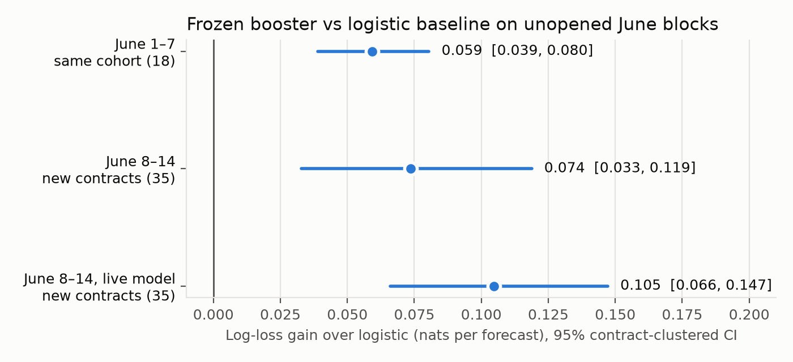
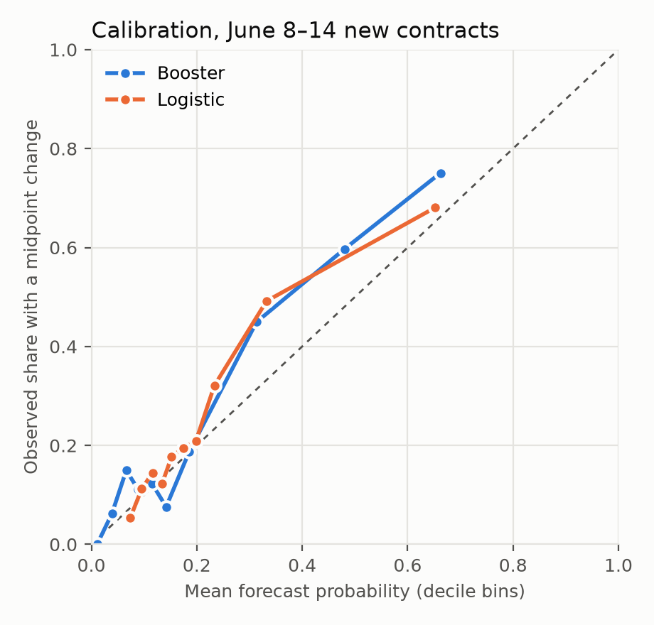
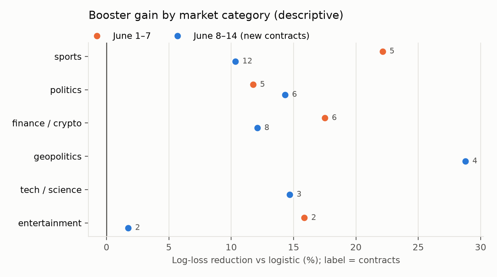

# EventX: final report (DRAFT — live and V4 sections pending Friday 30 Oct)

**Student:** Zhu Rong · **Supervisor:** Lu Yao · **Due:** 1 November 2026
**Status of this draft:** written 27 Oct 2026. The two placeholders marked `[PENDING]` are filled from once-only evaluations that open on 30 Oct. Every other number is from a completed, frozen evaluation.

## 1. Summary

EventX asks whether external information (news, later KOL posts) contains incremental, point-in-time predictive information about prediction-market repricing. The project has two answers so far.

1. **News on top of market history: negative.** In the frozen V3.1 historical study (4,651 markets), adding counts of conservatively available, lexically associated news articles to a market-history logistic model made both average precision and Brier score worse, by AP −0.001916 and Brier −0.000284. The paired block-bootstrap Brier interval was [−0.000341, −0.000230], and all five promotion gates failed. Later opened-data diagnostics (V5/V6) traced apparent news gains to context or nonlinearity controls. The richer-news V4 confirmation (470 Polymarket contracts, 6 Sep–30 Oct) is sealed and still collecting. **[PENDING: V4 B3-vs-B0 result]**
2. **A forecastable microstructure target: positive, replicated out of time and on new contracts.** The project defined a narrower target: the probability that a contract's YES midpoint changes within 30 minutes. A frozen gradient-boosted classifier on 18 quote and activity features beats every baseline in every evaluation block:

| Block | Opened before? | Contracts | Booster LL | Logistic LL | LL reduction | 95% contract-clustered CI of gain (nats) |
|---|---|---:|---:|---:|---:|---|
| May 9 (development) | yes, repeated use | — | — | — | 16.0% (V03) | — |
| May 13–19 replication | first use | 30 | 0.3583 | 0.4524 | 20.8% | — |
| **June 1–7, unopened** | no | 18 | 0.2931 | 0.3523 | **16.8%** | [0.039, 0.081] |
| **June 8–14, unseen contracts** | no | 35 | 0.4208 | 0.4943 | **14.9%** | [0.033, 0.119] |
| June 8–14, V03 live model | no | 35 | 0.4270 | 0.5316 | **19.7%** | [0.066, 0.147] |
| **June 15–28, unseen contracts** | no | 21 selected | [PENDING] | [PENDING] | [PENDING] | [PENDING] |
| **Live, 27–29 Oct** | prospective | 30 | [PENDING] | [PENDING] | [PENDING] | [PENDING] |

The target is quote *activity* only. It says nothing about direction, size, resolution or profit, and it is not a test of news.

## 2. Track A — news increment (V3.1, V4, V5/V6)

*Source: [9 Oct report](MARKET_NEWS_RESEARCH_PROGRESS_20261007.md); controlling protocols are cited there.*

- **V3.1 historical primary (complete).**
  - Data: 3,832 Kalshi and 819 Polymarket markets; development 17 May–22 Jul 2026; holdout 22 Jul–8 Aug.
  - B0 is a 12-feature market-history logistic ensemble; B1 adds 60/360/1,440-minute article counts.
  - Validation used five purged, expanding-time folds.
  - B1 failed H1–H5, so B0 alone was evaluated once on the holdout: AP 0.171628, Brier 0.107107 on 211,718 rows. A disclosed prevalence-exposure deviation applies.
- **V4 confirmatory (sealed).** This is a nested ladder: B1 news volume, B2 relevance and novelty, B3 publisher diversity and cross-publisher diffusion.
  - Primary contrast: B3 vs B0.
  - Success requires a ≥0.001-nat log-loss gain with a positive bootstrap lower bound, plus Brier and venue guards.
  - The label-blind health check on 27 Oct 01:09 UTC found the collector alive, 58/58 news days and 51/51 trade days with receipts, nothing pending, and 15/15 frozen hashes matching.
  - Close sequence, exactly once: audit → consume → prepare → build → evaluate. **[PENDING]**
- **V5/V6 (exploratory, opened data).**
  - In V5, a context-only gate and a nonlinear market-only model explained the apparent gain from a residual-news model. Adding the news mechanism changed LL by −0.000871, with interval [−0.001457, −0.000208].
  - V6 contract-aware linking failed its strict audit; certified support is 0/8,844 contract-days.

## 3. Track B — 30-minute quote-change forecasting

### 3.1 Target, features, models
- **Target:** at each 5-minute grid time t, 1 if the recorded Polymarket YES midpoint at t+30 min differs from the one at t (|Δ| > 1e-12). Strict freshness and spread gates decide whether a forecast is issued at all; missing endpoints are reported as unknown, never imputed.
- **Features:** 18 point-in-time quote and activity features (`row_hgb7`), or the 14-feature source-time variant (V03, the live model).
- **Models:** histogram gradient boosting. Every model was frozen before any evaluation block in the table above; there was no refit, recalibration or threshold change afterwards.
- **Baselines:** an activity/full-feature logistic regression, a legacy HGB, a global rate and a per-contract rate.
- **Data:** pmxt hourly Polymarket order-book archive. The 1,231 protected market IDs and all protected windows (OOT, V3.1 holdout, V4) are excluded at decode.

### 3.2 Evidence ladder
- **June 1–7 (unopened, same cohort).**
  - All 168 of 168 hours were captured.
  - 20 of 60 contracts were still active, giving 18,677 known outcomes.
  - Results: LL 0.2931 vs 0.3523, Brier 0.0848 vs 0.1003, AUC 0.835.
  - The booster wins on 7/7 dates and 17/20 contracts.
  - The all-issued missing-label bound is [−0.001, 0.100]. Its lower end is negative only if every unknown endpoint went against the booster.
  - Details: `EVENTX_JUNE_OUT_OF_TIME_TEST_20261026.md`.
- **June 8–14 (unopened, 40 new contracts selected by metadata only).**
  - 35 contracts contributed 35,218 known outcomes.
  - The booster wins on 7/7 dates and 27/35 contracts.
  - The missing-label bounds, [+0.009, +0.114], are positive under the worst case.
  - Protocol deviation: a DNS outage forced an outcome-blind refetch of 74 hours, beyond the single-retry rule. It is disclosed, and the original source is preserved.
  - Details: `EVENTX_NEW_IDENTITY_AND_RUNTIME_V02_20261026.md` §1.

- **June 15–28 (unopened, 21 new contracts).**
  - The cohort was frozen from metadata only, before any price read. The ID range is [0x18, 0x28), and a contract must end after June 22.
  - An earlier v1 selection with a stricter end-date rule found only 15 of 60. It was superseded before any price read and is preserved.
  - Capture was deferred until after the live window to protect the live test (§3.3).
  - Primary model `row_hgb7` and secondary V03 run in one once-only phase, with pass rules registered beforehand. **[PENDING]**
- **Calibration.** On June 8–14 both models are close to the diagonal below 0.2. Both under-predict at higher probabilities, the booster slightly less at the top.

  

- **By category (descriptive, post hoc keyword rule).** Categories come from `eventx/tasks/analyze_v7_category_breakdown_20261027.py`. The booster has lower log loss than logistic in every category in both blocks. The gain is not driven by one category.

| Block | Category | Contracts | Known | Booster LL | Logistic LL | Reduction | Contracts won |
|---|---|---:|---:|---:|---:|---:|---:|
| June 1–7 | sports | 5 | 5,670 | 0.2443 | 0.3138 | 22.1% | 5/5 |
| | politics | 5 | 5,425 | 0.3023 | 0.3426 | 11.8% | 4/5 |
| | finance/crypto | 6 | 3,670 | 0.2499 | 0.3030 | 17.5% | 5/6 |
| | entertainment | 2 | 1,688 | 0.5211 | 0.6194 | 15.9% | 2/2 |
| June 8–14 | sports | 12 | 11,498 | 0.4151 | 0.4630 | 10.3% | 9/12 |
| | finance/crypto | 8 | 7,167 | 0.6706 | 0.7630 | 12.1% | 6/8 |
| | politics | 6 | 6,927 | 0.2535 | 0.2959 | 14.3% | 5/6 |
| | geopolitics | 4 | 6,335 | 0.3515 | 0.4936 | 28.8% | 4/4 |
| | tech/science | 3 | 2,680 | 0.3894 | 0.4564 | 14.7% | 2/3 |
| | entertainment | 2 | 611 | 0.3495 | 0.3557 | 1.7% | 1/2 |

The contract-clustered intervals exclude zero for sports and finance/crypto in June 1–7, and for sports and geopolitics in June 8–14. In the June 1–7 politics category the lower bound is barely positive, at 0.0008. Other categories have too few contracts for an interval to be informative.

### 3.3 Prospective live test (V02 runtime)
- **Engineering history.** The V01 runtime failed readiness on host-clock discipline. Two V02 activations were superseded with zero forecasts: one for memory cost, one for a thread race in the hash chain. All failures are preserved.
- **What V02 changed.** It adds an SNTP-validated corrected clock, bounded incremental inputs and a single-pass, once-only evaluator.
- **Readiness.** It passed on 26 Oct: 156/180 decisions ready, 27/30 contracts.
- **Activation.** Activated 26 Oct 17:53:53 UTC. Grids run 27 Oct 00:30 to 29 Oct 23:25 UTC, with 30 metadata-selected contracts and 24,840 scheduled decisions.
- **Host stall.** From 03:24 to 04:41 UTC on 27 Oct, a concurrent analysis job pushed the host, already short of memory, into heavy swapping. The result was 4 missed grids plus warmup abstentions; all fail-closed. No heavy jobs now run until the close. Separately, the venue WebSocket drops about once an hour or more, and each drop costs a 30-minute warmup by rule.
- **Known defect.** On the first grid (00:30) all 30 decisions abstained. A wrapper handoff skipped one input refresh. The failure is fail-closed and affects 0.12% of the schedule.
- **Result:** [PENDING — run `evaluate_v7_forecast_runtime_20261026_v02` once after 29 Oct 23:57:30 UTC; report coverage, LL/Brier/AUC vs baselines, the contract-clustered CI and missing-label bounds whatever the sign.]

## 4. Limitations
- **Venue and cohort.** Track B covers one venue (Polymarket), and its cohorts are modest: 18–35 contributing contracts. Observations within a contract are dependent, which is why the intervals are contract-clustered.
- **Metadata timing.** Historical replays use current rather than as-of metadata; only the live test is truly prospective.
- **Target scope.** Quote-change activity is a microstructure target. A good score does not imply tradable edge, a directional signal or news value.
- **Unresolved data gaps.** In Track A, news availability is conservative but not first-delivery certified, and missing feeds are treated as unknown. KOL/social research was deferred.

## 5. Reproducibility
Frozen releases are under `eventx/release/v7/{june_replication_20261026,new_identity_test_20261026,forecast_runtime_20261026_v02}/`, and results under the matching `data/v7/` directories. `CURRENT_STATE.md` is the handoff, and `docs/progress/2026-10.md` the log.
