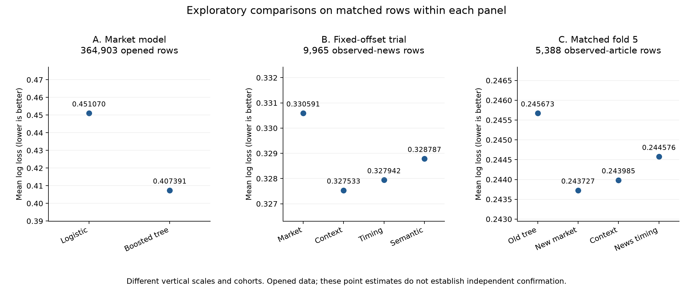

# Does Timestamped News Improve Short-Horizon Prediction-Market Repricing Forecasts? Historical Evidence and Exploratory Controls

**Draft:** 10 October 2026; expanded Paper A revision 2  
**Authors and affiliations:** to be supplied  
**Study status:** Completed V3.1 historical study, separate V4 historical discovery, and opened V5 model/control experiments. V4 prospective confirmation remains pending. This version preserves the 4 October draft and introduces no new forecast evaluation.
**Supporting materials:** [Generated aggregate tables](eventx/release/paper_a_20261010/TABLES.md), [full-precision evidence and source hashes](eventx/release/paper_a_20261010/evidence.json), [figure](eventx/release/paper_a_20261010/matched_comparisons.pdf), and [claim review](eventx/release/paper_a_20261010/CLAIM_REVIEW.md).  
**Scope of claim:** Predictive performance for the specified Lumid-sourced cohort, news representation, learner, and dates. No causal, trading-profit, social-virality, or universal news-null claim.

## Abstract

Prediction-market prices aggregate beliefs, making market history a demanding comparator for external news. We examine whether conservatively timestamped publisher news improves prediction of large absolute canonical-YES log-odds movements over the next 30 minutes. A completed historical study used 4,651 Kalshi and Polymarket markets from 17 May to 8 August 2026. A frozen logistic market-history model (B0) was compared with the same learner plus news counts (B1), using purged expanding-time validation and held-out market groups.

Across 1,460,454 matched development predictions, B1 reduced average precision from 0.193294 to 0.191378 and increased Brier score from 0.119209 to 0.119494, failing all five promotion conditions. Only the selected B0 fallback was evaluated on the historical holdout: 211,718 observations from 300 markets yielded AP 0.171628 and Brier 0.107107, with a disclosed receipt-order deviation. This is not a held-out news comparison. Separate opened-development experiments found substantial market-model gains: removing terminal predictors, a shallow boosted tree reduced matched log loss from 0.451070 to 0.407391 on 364,903 observations. An observed-news correction study improved over its original tree through context recalibration, while adding timing and relevance–novelty features worsened loss relative to that control. In a broader adaptive search, the selected news model scored 0.244576 versus 0.243727 for the stronger market-only model on 5,388 identical observed-article reporting-fold observations.

The completed news-count selection result and exploratory control comparisons support a bounded account of tested representations. They do not establish that public news lacks predictive value or that markets are fully informationally efficient. Baseline strength, exposure context, conservative availability, contract applicability, and dependent information episodes constrain interpretation. A separately frozen 470-market prospective study remains unevaluated.

**Keywords:** prediction markets; news; point-in-time data; repricing; forecast evaluation; data provenance

## 1. Introduction

Prediction markets aggregate traders' information into contract prices [1]. External news may precede a price adjustment, but the timestamp printed by a publisher is not necessarily the time at which a research system could observe the article. A delayed ingestion, retrospective backfill, duplicate article, or interrupted feed can make a historical news signal look more timely or more complete than it was. Repeated observations from the same market can also give a misleading impression of sample size.

We ask a deliberately narrow predictive question: **does the count of market-associated articles available by a decision time improve prediction of a 30-minute absolute canonical-YES repricing event beyond executed-market history?** This differs from predicting eventual contract resolution or the direction of a trade. It also differs from estimating the causal effect of a particular article.

Our completed historical experiment compared a fixed market-history model with the same learner plus three rolling news-count features. A fifth preregistered promotion condition guarded against an aggregate gain that came at the expense of either venue. The news model failed every condition in development. The protocol then selected a market-only candidate for a single historical holdout evaluation. We report that absolute benchmark and the exact limits of its interpretation.

This paper contributes (i) an auditable short-horizon task and source-bounded information clock, (ii) a fully reported negative historical model-selection result and selected-model holdout benchmark, and (iii) exploratory evidence that nonlinear market modeling and exposure-context calibration alter the standard against which news is evaluated. The experiments have different cohorts, metrics, and selection histories, which we retain as separate evidence blocks. Gradient boosting itself is an established method and is not the algorithmic novelty of this study.

The broader question is when observed external information has incremental predictive value after market history and exposure context are accounted for. The completed study tests article counts; later development comparisons motivate stronger controls and improved measurement. They do not identify why a particular news representation fails, and they cannot replace independent confirmation.

## 2. Related work and positioning

Wolfers and Zitzewitz describe prediction markets as mechanisms for aggregating dispersed information and emphasize the dependence of their usefulness on market design [1]. Work on media and conventional asset markets shows why external text is a plausible signal, while also showing that media content and market responses need careful interpretation [2]. Pennock and colleagues linked changes in news vocabulary to political prediction-market events [3]. Vaughan Williams and Reade studied the timing of Twitter activity and Betfair price adjustment around one political event [4].

Our unit is a five-minute market-time observation across many contracts. Our measured external signal is publisher article *count*, not Twitter activity, media tone, validated article-to-contract semantics, or true social diffusion. The outcome is a future unsigned price movement over 30 minutes. The analysis asks whether that representation adds out-of-fold predictive performance to an executed-trade baseline under conservative data-availability rules.

Recent work further sharpens the comparison. Angelini and De Angelis study sequential public signals and find incomplete immediate price adjustment and subsequent drift, with liquidity-dependent patterns [5]. Those results motivate an information-absorption hypothesis but do not establish that publisher text available through EventX has the same properties. Gong and Dimitrov examine daily AI-extracted text beyond price benchmarks for next-day downside-tail assessment [6]; our horizon, unsigned repricing target, and source-clock policy differ. Ibrahim and Zaki document news sentences quoting prediction-market odds and elevated subsequent citation after price dislocations [7]. This motivates tracking market-derived reporting separately from external evidence; the current EventX forecast comparisons have not isolated that information role.

The inspected full-text methods clarify two distinctions. Angelini and De Angelis align quote midpoints with structured game states and cross-fit a public-information probability benchmark by game; EventX currently has no comparable value benchmark for textual news. Ibrahim and Zaki distinguish citation precision from developmental recall and disclose measurement development across their full corpus. This motivates separate miss sampling and explicit measurement chronology here. See the [focused method comparison](eventx/release/paper_a_review_20261010/LITERATURE_METHOD_COMPARISON.md).

The targeted positioning check does not establish a first-of-kind claim. The SSRN full-method comparison and a broader literature review remain before submission.

## 3. Data and prediction task

### 3.1 Sources, cohort, and windows

All observational market, trade, news, and run-provenance data came from Lumid FinData's bounded warehouse retrieval. The claim is about rows present in that warehouse, not completeness of all published news. The label-blind v3.1 cohort contains 4,651 binary markets: 3,832 Kalshi and 819 Polymarket. A market required Lumid metadata available before the development interval closed, a unique canonical YES outcome, at least 100 positive-notional canonical-YES development executions, and activity on at least 10 UTC days. The development interval was `[2026-05-17, 2026-07-22)` UTC. The one-shot historical holdout was `[2026-07-22, 2026-08-08)` UTC.

Cohort membership is outcome-blind but retrospective: its activity conditions use the development interval as a whole, and metadata availability is checked before that interval closes rather than before every historical prediction time. The evaluation therefore conditions on this selected historical cohort; it does not demonstrate a deployable universe-selection policy available at each decision time. Conservative feature clocks do not resolve that cohort-selection limitation.

The v3.1 cohort is a disclosed, pre-outcome correction to the original v3 data gate. That gate found 204,069 Kalshi rows with zero executed contracts. Removing such records from execution calculations left 19 of the original 4,670 markets below the frozen activity minimum. V3.1 removed exactly those 19 before any development label or model result was inspected; the failed v3 gate remains preserved.

### 3.2 Decision time and outcome

For each market, the primary price at five-minute UTC time `t` is the last executed canonical-YES trade observed at or before `t`. Polymarket uses the unique YES asset price; Kalshi YES prices are converted from cents. We carry that last trade forward and record its age. We do not switch the primary series to candles or order-book midpoints. Prices are clipped to `[0.0001, 0.9999]` before conversion to log-odds.

Let `p_t` be this canonical-YES price. For the 30-minute horizon, the unsigned movement is `|logit(p_(t+30)) − logit(p_t)|`. The binary label is one when that movement meets or exceeds `4 × sigma_(1m, trailing 240m)(t) × sqrt(30/30)`, with the frozen implementation's minimum of 30 trailing volatility observations. The factor of four is a **preregistered heuristic event threshold**; it is not a claim that the event is four horizon-standard deviations from a Gaussian mean. Rows lacking the required history, recent activity or full pre-terminal horizon are excluded under the frozen eligibility rule. No forward-liquidity filter is used.

### 3.3 News identity, availability, and association

The frozen news rule associates article headline and summary text with markets. A stable document identity is counted once at its earliest conservative availability time. Conflicting publication timestamps for the same normalized URL are quarantined. The effective clock is the maximum of publication time, server ingestion time, and the joined source run's start and end times when present. This is deliberately later than an article's printed publication time when ingestion or run completion was later. It is a conservative research decision clock, not a measured first-client-delivery timestamp. Rows with missing required provenance or more than 24 hours between publication and derived availability are excluded from the primary news features.

The frozen development association inventory contained 218,496 article-market associations from 147,377 documents; 1,420 of the 4,651 markets had at least five associations. These figures describe candidate feature support, not semantic accuracy or complete provider coverage. A failed or partial upstream run does not certify a zero-news interval. The frozen source claim therefore remains conditional on the rows actually retrievable from Lumid.

## 4. Models and evaluation

**B0 (market history)** has 12 features: current price log-odds; momentum over 5, 30, and 120 minutes; realized volatility over 30 and 240 minutes; executed-trade count and notional over 60 and 240 minutes; minutes since the latest trade; and a venue indicator. **B1 (market history plus news)** adds article counts over 60, 360, and 1,440 minutes and a schema-retained `news_symbol_mapped` indicator. The last feature is constant zero in this frozen study because a canonical event-market financial-symbol map was unavailable. Thus the tested increment is effectively the three rolling counts.

Both candidates use the same standardized logistic stochastic-gradient learner, eight epochs, L2 parameter 0.0001, fixed learning rate 0.02, and an arithmetic mean of predicted probabilities from seeds 11, 23, and 47. Count and notional features receive `log1p`; standardization is fitted on each training fold only. No hyperparameter search was conducted for this comparison.

Development used five purged expanding-time folds. Each validation fold had an 11-day calendar window and one disjoint held-out market-hash group; training used eligible earlier rows from the other groups, with a 30-minute purge. B0 and B1 were scored on identical validation keys. Average precision (AP) was the primary ranking metric and Brier score the calibration-sensitive promotion metric. The prespecified B1 promotion rule required **all** of the following:

1. Positive aggregate out-of-fold `AP(B1) − AP(B0)`.
2. Positive aggregate out-of-fold `Brier(B0) − Brier(B1)`.
3. Both improvements positive in at least four of five folds.
4. A positive lower bound of a paired 95% moving-block-bootstrap interval for the Brier improvement.
5. Nonnegative Brier improvement separately on Kalshi and Polymarket.

The bootstrap used 5,000 paired circular blocks of 72 eligible five-minute rows within each market, nominally six hours per block. Its estimand is conditional on the frozen market cohort; the row count is not a count of independent markets. The protocol selected B1 for the single holdout only if every promotion condition passed; otherwise it froze B0.

### 4.1 Separate exploratory models and controls

The V5 audit uses already opened historical development inputs and three outer forward folds, numbered 3–5, with a 30-minute horizon purge and disjoint market IDs. Model families share capped 60,000-row training/tuning indices. L2 logistic, spline logistic, and histogram boosting were compared under no-terminal, market, timing, and semantic bundles; the recorded audit comprises 108 fits. Snapshot terminal metadata has incomplete historical version proof. The paired no-terminal diagnostic therefore compares models after removing terminal predictors from both, using existing frozen predictions. This does not repair upstream eligibility or source validity.

An additional correction study evaluates only rows with an observed article in the preceding 30 minutes. It preserves the original market tree's out-of-fold forecast and fits a regularized correction on exposed training rows. Context uses the market forecast; timing adds article count/age; semantic adds relevance–novelty. Fixed L2 penalty is 0.01. Forward training is fold 3 to fold 4, then folds 3–4 to fold 5, retaining horizon purging and market disjointness. There are 1,401/5,978 exposed training rows and 4,577/5,388 exposed validation rows. These are observed-article populations, not complete independently verified news windows. The correction's exposure definition inherits the historical association opportunity set, so its contrast concerns the recorded exposure proxy rather than all external news.

The later adaptive screen attempts 50 additional configurations: fixed-offset penalties and quadratic correction, spline logistic, histogram boosting, bagged/randomized trees, a small MLP, and CatBoost. Forty-five complete both forward folds; one semantic quadratic arm exceeds its declared feature budget, and four LightGBM/XGBoost configurations cannot load the local OpenMP runtime. These are preserved failures, not unfavorable model metrics. Within-screen selection uses fold 4; fold 5 is a reporting fold already opened by prior work. For the full-row market screen, the selected histogram booster has seven leaves, maximum depth three, 600 iterations, learning rate 0.05, L2 regularization 10, minimum leaf size 100, and seed 907. The selected observed-news model is a timing offset ridge with penalty 0.1; the selected context model is a quadratic offset. Exact feature grids, software versions, and contracts remain in the source artifacts.

Learned semantic representations inherit full-discovery text fitting, rather than strictly fold-local text fitting. All later development results are therefore exploratory and cannot supply a point-in-time semantic confirmation. Reported market-cluster intervals are descriptive, unadjusted for adaptive selection, related event families, or common calendar shocks. No learner was promoted to a new confirmation study.

## 5. Results

### 5.1 Prespecified historical development comparison

Development produced 7,706,324 eligible examples and 1,460,454 matched out-of-fold comparison observations. The jump rate on those observations was 0.141270. Table 1 gives aggregate metrics; a positive difference is favorable to B1.

| Metric | B0 market history | B1 plus news counts | B1 relative to B0 |
|---|---:|---:|---:|
| Average precision | 0.193294 | 0.191378 | −0.001916 |
| Brier score | 0.119209 | 0.119494 | −0.000284 Brier improvement |
| ROC AUC | 0.626311 | 0.622853 | −0.003459 |
| Equal-frequency ECE (10 bins) | 0.016942 | 0.018230 | +0.001288 |

The paired 95% moving-block interval for `Brier(B0) − Brier(B1)` was `[−0.000341, −0.000230]`. Both AP and Brier improved in **zero of five** folds. Brier improvement was negative for Kalshi (`−0.000285`) and Polymarket (`−0.000277`) separately. All five prespecified promotion conditions were false; B0 was selected. The interval supports a narrow conclusion about this development comparison under its within-market resampling scheme. It does not establish the effect of all possible news representations or generalization to a new market population.

### 5.2 One-shot historical holdout of the selected model

The holdout contained 211,718 eligible observations from 300 markets, including 26,381 labeled repricing events. Only the frozen B0 candidate was evaluated. Its AP was **0.171628**, Brier score **0.107107**, and ROC AUC **0.628037**; the jump prevalence was **0.124604**. Ten-bin equal-frequency ECE was 0.015317. The resulting AP exceeded prevalence, but this is an absolute benchmark for B0, not a held-out B1-versus-B0 comparison.

Performance varied by venue: AP was 0.192295 on 164,569 Kalshi observations and 0.139318 on 47,149 Polymarket observations. The carried-forward last-trade series was often stale: 179,054 of the 211,718 holdout observations had a latest trade more than five minutes old. The development-frozen alert threshold of 0.215509 issued 6,430 alerts, or 3.04% of observations, with positive predictive value 0.175583 and sensitivity 0.042796. These diagnostics describe the operational characteristics of the *market-only* candidate; they do not supply news lift or a trading return.

### 5.3 Separate historical discovery of richer news features

A later V4 design tested a nested ladder on an outcome-open historical Polymarket development interval. B0 used market history; B1 added volume; B2 added frozen relevance and market-relative novelty; B3 added publisher diversity and exact-headline cross-publisher diffusion. On 745,443 identical out-of-fold observations, log loss was 0.459158 for B0, 0.461659 for B1, 0.461946 for B2, and 0.465617 for B3. The B3-versus-B0 improvement was `−0.006459` nats per row, with a paired historical interval of `[−0.007411, −0.005545]`. Brier score and AP also favored B0 over B3 in this development comparison.

This analysis used a different, Polymarket-only cohort and an interval whose outcomes had already been opened. Its semantic transform was fitted on the full discovery text before forward folds, introducing a future-text limitation for its historical comparison. It is **exploratory** and cannot confirm the v3.1 result, test social virality, or substitute for V4's untouched future evaluation. Its practical role here is to show that simply adding richer publisher-news proxies did not resolve the observed historical weakness under that fixed implementation.

### 5.4 Baseline nonlinearity on opened development

On 364,903 identical rows from 1,135 contracts, the paired no-terminal tree comparison improves over logistic across all three forward folds:

| Market-only model without terminal predictor | Log loss | Brier | AP |
|---|---:|---:|---:|
| L2 logistic | 0.451070 | 0.140952 | 0.226649 |
| Shallow boosted tree | 0.407391 | 0.131106 | 0.334964 |

Log loss improves by 0.043679 nats per row, a 9.683467% reduction. The reported descriptive market-cluster interval is [0.039575, 0.047682]; forward-fold improvements are 0.041469, 0.035980, and 0.053605. This is a post-selection diagnostic of existing opened-data predictions. It motivates a stronger market control for a subsequent study and does not independently confirm that redesigned baseline.

In the later full-row screen, the fold-4-selected seven-leaf booster improves fold-4 loss from 0.441017 to 0.439301 and already opened fold-5 loss from 0.348884 to 0.344816 on 112,616 rows. The latter gain is 0.004068, with descriptive interval [0.002841, 0.005276]. A post-hoc CatBoost fold-5 score of 0.343900 is lower, but it had worse fold-4 performance and its paired interval versus the selected booster includes zero. It was not promoted from the reporting fold.

### 5.5 Exposure context and the incremental news comparison

The fixed-offset trial contains 9,965 observed-news rows from 219 markets:

| Arm on identical observed-news rows | Log loss | Brier | AP |
|---|---:|---:|---:|
| Original market tree | 0.330591 | 0.107047 | 0.373627 |
| Exposure-gated context | 0.327533 | 0.105861 | 0.374094 |
| Context plus timing | 0.327942 | 0.105982 | 0.372586 |
| Timing plus relevance–novelty | 0.328787 | 0.106183 | 0.373029 |

The full semantic correction improves over the original tree by 0.001804, but is 0.001254 worse than the context control. Thus the favorable comparison against the original tree does not identify article-content value. Context's 0.003058 gain has descriptive interval [0.000662, 0.005552]. Timing versus context is −0.000410, and semantic versus timing is −0.000844 with interval [−0.002080, 0.000199]. These findings describe the recorded exposed population and do not establish full-feed effects.

The exact cross-screen `(market, minute)` join gives the stronger-control comparison on 5,388 identical observed-article fold-5 rows:

| Arm | Log loss | Brier | AP |
|---|---:|---:|---:|
| Original market tree | 0.245673 | 0.078771 | 0.350843 |
| Selected stronger market booster | 0.243727 | 0.078230 | 0.355478 |
| Selected context correction | 0.243985 | 0.078174 | 0.350843 |
| Selected news timing correction | 0.244576 | 0.078265 | 0.350656 |

Selected news is worse than the stronger market control by 0.000849 and worse than selected context by 0.000591. Its descriptive market-cluster interval for improvement versus the stronger market control is [−0.004221, 0.002996]. That interval includes gains larger than 0.001 and is unadjusted for selection and shared shocks; it cannot exclude a practically useful content effect in a new population. Selected news also loses to both controls in fold 4. The post-hoc best fold-5 semantic offset has loss 0.243699, but much weaker fold-4 loss, and supplies no confirmation.

**Figure 1.** Mean log loss on matched rows within each panel. Panels use different cohorts and vertical scales. Values are point estimates exported from existing aggregate JSON; they do not represent independently confirmed gains. Full-precision tables and provenance are in the [aggregate appendix](eventx/release/paper_a_20261010/TABLES.md).

### 5.6 Prospective study status

A separate V4 protocol froze B0–B3 for 470 active Polymarket markets over `[2026-09-06, 2026-10-30)` UTC. The primary contrast is B3 versus B0 mean row log-loss improvement. Success requires at least 0.001 nats per row, a paired bootstrap 95% lower bound above zero, Brier improvement at least −0.0005, and the eligible-venue nonnegative guardrail. Source-completeness failure makes the news confirmation incomplete. The post-close execution order is collection audit, consumption receipt, point-in-time preparation, sealed examples, and one-shot evaluation, stopping at a failed gate.

This manuscript reports no V4 prospective outcome. The later V5 learner search cannot replace the frozen V4 market control. Any eventual V4 result must be presented for that frozen design, with its source and inference scope, rather than pooled with the historical and adaptive experiments.

## 6. Discussion

The strongest completed inference is procedural and predictive: the preregistered count-based news model did not qualify for holdout selection, while the selected market-only model gave a measurable but modest absolute holdout benchmark. The paired development point estimate and interval are unfavorable to B1 under the stated within-market resampling assumptions. It cannot rule out gains from a better article-to-contract link, richer semantic features, a different learner, cleaner feed coverage, or a different period. Such questions require their own frozen designs and untouched evaluation samples.

Several mechanisms could explain the observed B1 failure, but this study does not identify one causally. The market-history features may already absorb much public information by the time an article enters the Lumid feed. Rolling article counts may pool material market-moving reports with incidental topical mentions. Sparse association coverage means most markets have little measured news exposure. Conservative availability times can exclude a prompt publisher signal that the research system could not verify as available. Finally, warehouse rows cannot establish the completeness of all upstream articles or every failed run's requested page window. These are hypotheses and measurement limits, not post hoc corrections to the frozen result.

The historical V4 discovery result points in the same descriptive direction for its own model family, but the cohorts, metric hierarchy, and data status differ. We therefore report it separately and do not pool estimates or call it replication. The pending V4 prospective test remains governed by its original frozen dates and one-shot execution order. Publishing the present historical study does not authorize an early or revised V4 evaluation.

The opened control studies suggest two practical evaluation lessons. First, nonlinear market-state relationships account for substantially more development loss reduction than the tested added-news representations. Second, a correction conditioned on recorded article exposure can improve a forecast without improving the semantic signal. Neither is a causal decomposition: the learner families, exposure proxy, source quality, and selection histories constrain the comparison.

Availability, relevance, novelty, and assimilation organize the unresolved mechanisms. Availability asks what the system could observe by prediction time; relevance asks whether the article concerns the correct predicate and episode; novelty asks what differs from previously observable information; assimilation asks whether that information predicts later repricing after the observed market state. The present experiments do not isolate all four. Contract linking has known development failures, but no oracle-link forecast contrast attributes the negative result to those failures. A new event-based study would need independent evidence spans and episode definitions, pre-event expectations for measured surprise, source-valid clocks, and market/quote measurement capable of distinguishing remaining adjustment from stale executions.

Such a future design could make a forecast after a declared short landmark, allowing initial market reaction to enter the controls only once it has been observed. Information favoring contract YES is distinct from the probability of a future repricing event; direction and surprise cannot be inserted into the latter probability mechanically. These are future research questions, not additional results of this manuscript.

## 7. Limitations and integrity disclosures

First, the observational source is a bounded Lumid warehouse extract. The run join establishes conservative timing for observed article rows, but it is not a certificate that every provider page, symbol, or zero-news window was complete. `available_at` is derived from several timestamps and does not measure per-client delivery. Article content and market-term revision histories are not fully versioned in the accessible source. The result should be interpreted as a test of the frozen, source-bounded representation.

Second, a lexical article-market association is only a candidate relevance rule. This study did not conduct a comprehensive, independent audit of semantic applicability for every pair. The `news_symbol_mapped` feature is constant zero. Cross-publisher diffusion in V4 is distinct from social sharing, reposts, impressions, or KOL influence; the completed v3.1 experiment tests none of those channels.

The retrospective cohort activity screen and late metadata availability also limit the deployment interpretation; outcome-blind cohort choice alone does not establish point-in-time universe eligibility.

Third, the target is a thresholded, unsigned log-odds movement in a last-trade series. Stale trade prices, venue-specific market structure, endpoint changes, and the chosen heuristic threshold affect interpretation. The 300 eligible holdout markets are fewer than the 4,651-market development cohort. Millions of five-minute rows do not erase dependence within markets or create millions of independent contracts. The within-market block interval conditions on the selected cohort and may not capture dependence across related market families or shared news events.

Fourth, the original v3 activity gate failed on zero-notional Kalshi records and led to the exact 19-market, label-blind v3.1 correction described above. The holdout builder later wrote a summary of 26,381 positive labels and prevalence 0.124604 **before** the consumption receipt, contrary to the stronger intended receipt order. No candidate predictions or performance metrics were read at that point; the B0 candidate, transforms, and evaluation formulas had been frozen. The deviation and receipt amendment are preserved. The holdout is therefore a one-shot evaluation **with a disclosed procedural deviation**, not an untouched-label demonstration under the original receipt-order wording.

Finally, B1 was not run on the consumed holdout, and it must not be reconstructed there after observing B0's result. This paper supplies no held-out estimate of the incremental value of news. It supports the narrower development-selection finding and B0 absolute holdout performance.

Additional development limitations concern model search, sparse and reused information events, upstream snapshot eligibility, and learned text transforms fitted with later development documents. Market-disjoint folds do not establish event-family independence. Previous redesign inference candidates failed persistence/regime simulations, so the exploratory cluster intervals do not establish broad generalization. A confidence interval including zero and useful positive gains is inconclusive, not evidence of equivalence. The 9.68% market-model improvement is development evidence and has no independent redesigned-model holdout here.

## 8. Conclusion

In the completed historical EventX study, conservatively available, lexically associated article counts failed all five development promotion conditions. Only the selected market-history model was evaluated on the historical holdout, giving AP 0.171628 and Brier 0.107107 with a disclosed procedural deviation. Separate opened-development comparisons show substantial nonlinear market-model gains and exposure-context recalibration, while the selected news additions fail to beat the relevant stronger controls. These evidence blocks support narrower claims about tested representations, measurement, and comparator choice. Independent prospective news confirmation remains pending, and the results do not establish universal news inefficiency, market informational efficiency, or trading profitability.

## References

1. Wolfers, J., & Zitzewitz, E. (2004). [Prediction Markets](https://www.aeaweb.org/articles?id=10.1257/0895330041371321). *Journal of Economic Perspectives*, 18(2), 107–126.
2. Tetlock, P. C. (2007). [Giving Content to Investor Sentiment: The Role of Media in the Stock Market](https://onlinelibrary.wiley.com/doi/10.1111/j.1540-6261.2007.01232.x). *The Journal of Finance*, 62(3), 1139–1168.
3. Pennock, D. M., Debnath, S., Glover, E., & Giles, C. L. (2013 preprint). [Modelling Information Incorporation in Markets, with Application to Detecting and Explaining Events](https://arxiv.org/abs/1301.0594).
4. Vaughan Williams, L., & Reade, J. J. (2016). [Prediction Markets, Social Media and Information Efficiency](https://irep.ntu.ac.uk/id/eprint/29386/). *Kyklos*, 69(3), 518–556.

5. Angelini, G., & De Angelis, L. (2026). [When Do Markets Fully Process Public Information? Evidence from Real-Time Prediction Markets](https://arxiv.org/abs/2606.07811). Working paper, arXiv:2606.07811.
6. Gong, G., & Dimitrov, S. (2026). [When Text Helps: AI Text Signals for Calibration-Sensitive Tail-Risk Decisions in Prediction Markets](https://papers.ssrn.com/sol3/papers.cfm?abstract_id=7005158). Working paper, SSRN 7005158. Positioning here is based on the indexed abstract; full methodological comparison remains pending.
7. Ibrahim, H., & Zaki, Y. (2026). [Price Dislocations, News Citations, and Epistemic Leverage on Polymarket](https://arxiv.org/abs/2609.06005). Preprint, arXiv:2609.06005.

## Internal evidence and submission checks

This section is an audit aid for the draft and can be converted to a public reproducibility appendix after source-rights review. It is not a claim that raw Lumid records can be redistributed.

- Frozen v3.1 design: `eventx/release/v3_1_historical_primary/protocol.json`; implementation: `eventx/release/v3_1_historical_primary/IMPLEMENTATION_SPEC.md`.
- Development selection: `data/v3_1_historical/primary/development/selection_result.json`.
- Holdout evaluation and receipt: `data/v3_1_historical/primary/holdout/evaluation_result.json`, `data/v3_1_historical/primary/holdout/holdout_consumption_receipt.json`.
- Disclosed deviation: `eventx/release/v3_1_historical_primary/HOLDOUT_PROTOCOL_DEVIATION.md`.
- V4 historical discovery: `data/v4/discovery/models/result.json`; prospective protocol: `eventx/release/v4/protocol.json`.
- Before submission: independently verify every table value against these frozen files, audit claim wording and artifact hashes, confirm what code/aggregate data can be shared, and supply author details and the venue's formatting requirements. No protected V4 holdout inspection is required for this manuscript.

The expanded version's aggregate exporter reads existing result JSON only, checks the historical consumption receipt before its published aggregate, records source SHA-256 values, and verifies selected source report/contract hashes against their manifests. It does not rerun evaluators, read raw labels/predictions, or inspect V4 sealed payloads. It is a publication export, not a new research freeze. See [export manifest](eventx/release/paper_a_20261010/manifest.json) and [claim review](eventx/release/paper_a_20261010/CLAIM_REVIEW.md). Independent review, complete source rights, full literature coverage, author details, and venue preparation remain before submission.

Revision 2 adds cohort-selection disclosure and inspected full-text methodological distinctions without changing numerical results. Independent scientific review is requested in the [review package](eventx/release/paper_a_review_20261010/REVIEW_REQUEST.md); none has yet been received.
