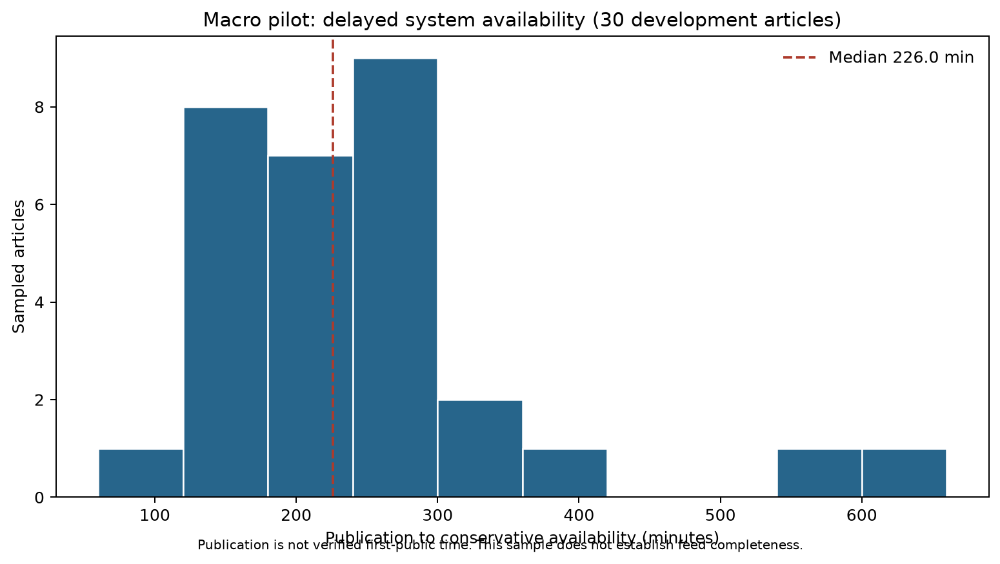
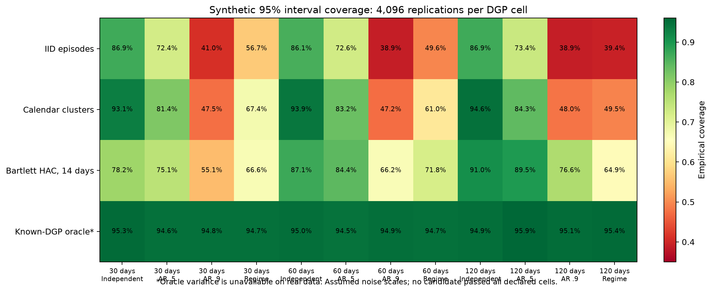

# V7 macro pilot preparation: results

Date: 10 October 2026. These are measurement-preparation and synthetic design results, not new forecasting performance.

## Development frame and review packet

| Quantity | Result |
|---|---:|
| Routed retained article rows before exact-content deduplication | 1,636 |
| Distinct routed article content | 1,619 |
| Availability-date × route buckets | 148 |
| Sampled articles / buckets | 30 / 30 |
| Distinct availability dates | 26 |
| Domain contract cards / provisional source event IDs | 122 / 38 |
| Review pairs / unique contracts | 120 / 66 |
| Top-one / alternatives / lower-ranked / outside-top20 pairs | 30 / 30 / 30 / 30 |
| Contracts with resolution text before / after bounded recovery | 0 / 64 of 66 |
| Review pairs with recovered rule text | 116 of 120 |
| Earlier context entries supplied | 86 |
| Independent reviewer responses / validated information episodes | 0 / 0 |

Route composition is 15 monetary-policy, six inflation and nine employment articles. These keyword routes are unvalidated domain hypotheses. The 30 buckets are not 30 independent news episodes. Sampling weights and all strata are recorded before new labels; scores/strata are absent from the review packet. Exact exclusions cover 800 prior/reserved article IDs and content hashes, with reserved records projected solely for exclusion. This new development frame does not reopen the failed V6 audit.

The material preparation improvement is resolution-text coverage: 64/66 contracts (96.97%) and 116/120 pairs (96.67%), compared with no rule text supplied by the original domain cards. It does not establish semantic accuracy or historical version validity. Three exact-ID source requests returned HTTP 200 and all 66 records, with verified data hashes.

## Availability and nominal-window diagnosis

| Diagnostic | Result |
|---|---:|
| Publication to derived availability: minimum / median / maximum, minutes | 90.839100 / 226.000252 / 610.276250 |
| Sampled articles with lag greater than 30 minutes | 30 / 30 |
| Source runs marked failed / ok / partial | 17 / 12 / 1 |
| Pairs with retrieved metadata snapshot later than article clock | 63 / 120 |
| Pairs before nominal opening / at or after nominal close | 8 / 34 |
| Pairs with room for a five-minute landmark plus 30-minute horizon under nominal bounds | 78 / 120 |

The supported timing question is remaining adjustment after system access. The sampled source clock is 90.84–610.28 minutes after publication, not a measured first-public clock. Failed/partial status neither proves a retained article invalid nor certifies completed windows. Nominal bounds and early snapshots do not prove historical active status. The 78 nominally compatible pairs have no independently reviewed relevance or verified source admission; they cannot be called eligible forecast episodes. Current labels can be developed without a support-day certificate, while any independent forecasting claim requires its own evidence.

## Fixed synthetic inference screen

The prewritten specification used 4,096 replications per DGP cell, 30/60/120 calendar days, capped Poisson episode arrivals, shared calendar shocks, AR persistence and a random half-period regime shift. Calendar and episode noise SDs are assumed at 0.02 nats, with a 0.015-nat regime shift SD. These are sensitivity assumptions, not empirical EventX loss scales. It directly simulates paired losses without fitting forecasts. Four methods across 12 DGP cells give 48 coverage rows; two alternative gains give 96 power rows.

| Candidate | Cells passing the declared coverage/type-I gate | Worst empirical 95% coverage |
|---|---:|---:|
| iid_episode_normal | 0 / 12 | 0.388672 |
| calendar_cluster_normal | 2 / 12 | 0.472168 |
| bartlett_hac_14_normal | 0 / 12 | 0.551270 |

None is adopted. Under the known-DGP oracle, the 120-day 80%-power reference detectable effect is 0.007743 nats for independent day shocks and 0.022100 for AR(0.9). At a true 0.001-nat gain, corresponding simulated probabilities of a positive lower bound are only 0.050781 and 0.034180. Oracle variance is unavailable in a real study; these numbers illustrate the assumed design's weakness, not a calibrated real sample-size requirement. The pilot's actual paired-loss scale and independent episode yield remain unknown. A practical threshold must not be changed to hide inadequate power.

## Execution state

- Sampling plan, rubric, real review packets, response intake implementation and budgets: prepared.
- Contract rule recovery and source/window feasibility: completed as descriptive development work.
- Synthetic uncertainty/power screen: completed; all three candidates fail the all-cell gate.
- V7 grid and event-study specification: written, not confirmatory-frozen.
- Independent annotations/adjudication, deployable semantic features, empirical paired-loss comparison and final inference: pending.
- New untouched evaluation dates and forecasting freeze: pending those design gates.
- Paper A: revision 2, independent-review request, method-positioning comparison and rights inventory prepared; no independent judgment or rights clearance received.
- V4: latest label-blind health receipt is [10 October 00:40:11 UTC](../../../../data/v4/health_checks/20261010T004011Z/report.json). Collector and guard alive; 41 news days/34 trade days through 9 October, 41/340 receipt sets, zero backlog, 15/15 frozen hashes matching. No protected downstream artifact exists. After the 30 October UTC close, preserve audit → consumption receipt → preparation → examples → one-shot evaluation and stop on any failed gate.

## Immediate next input and runnable handoff

Return two independent human response files using [review handoff](REVIEW_HANDOFF.md). This unlocks actual episode/role/direction/novelty diagnostics. Run the written intake once per submitted version; preserve originals and one adjudication. Source gaps and untouched-date choices cannot be inferred from those semantic labels. The separately prepared Lumid source request remains unsent because no destination/authorization to send was supplied.

Sources: [pilot](../../../../data/v7/macro_pilot_20261010/report.json), [rule recovery](../../../../data/v7/macro_metadata_20261010/report.json), [feasibility](../../../../data/v7/macro_feasibility_20261010/report.json), [simulation](../../../../data/v7/episode_inference_screen_20261010/report.json), [sampling plan](SAMPLING_PLAN.md), [rubric](ANNOTATION_RUBRIC.md), [study specification](STUDY_SPEC.md), and [paper review](../../paper_a_review_20261010/REVIEW_REQUEST.md).
